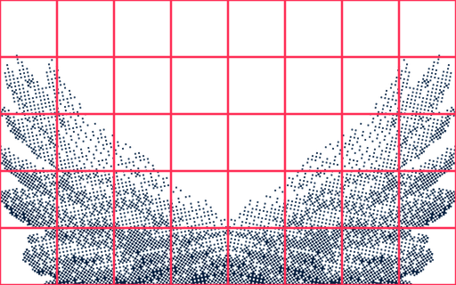
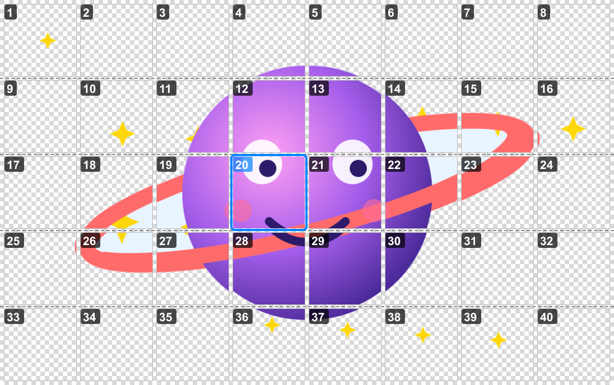

# teletools

[](LICENSE)

[](https://grammy.dev)

A Telegram bot: send it a PNG as a file, set a grid, and the bot slices the image into tiles, removes the background and creates a **sticker pack** or an **emoji pack**. The finished pack can be edited right in the chat: move, replace and delete tiles.

<table>
  <tr>
    <th>Source PNG</th>
    <th>8×5 grid preview (background removed)</th>
  </tr>
  <tr>
    <td></td>
    <td></td>
  </tr>
</table>

## Features

- Slices an image on a grid up to 20×20, with automatic row count based on aspect ratio
- 512px stickers (up to 120) or 100×100 custom emoji (up to 200)
- Background removal by flood fill from the edges — matching colors inside the drawing stay intact
- Preview with the grid overlaid before the pack is created
- Theme-adaptive emoji: one-color packs are repainted to the text color — dark in light themes, white in dark ones
- Built-in pack editor: move, replace, change emoji, delete
- For emoji packs — a message assembled from the emoji themselves, row by row of the grid

## Quick start

Requires **Node.js 20+**.

1. Create a bot with [@BotFather](https://t.me/BotFather) (`/newbot`) and copy the token.
2. Clone the repository and install dependencies:
   ```bash
   git clone https://github.com/oxolegit/teletools.git
   cd teletools
   npm install
   ```
3. Create `.env` from the example and put your token in it:
   ```bash
   cp .env.example .env
   # BOT_TOKEN=123456:ABC...
   ```
4. Run:
   ```bash
   npm start
   ```

## Usage

The bot's interface is in Russian; button labels are given below as they appear in the bot.

1. Send the bot a PNG **as a file** (📎 → File), not as a photo — otherwise Telegram compresses the image and drops transparency.
2. Configure with the buttons:
   - **Stickers / Emoji** (`Стикеры / Emoji`) — pack type
   - **Columns / Rows** (`Колонки / Строки`) — grid size (up to 20×20); "Rows by aspect ratio" (`Строки по пропорции`) picks the row count to fit the image's shape
   - **Background** (`Фон`) — `Авто` / Auto (if the PNG is already transparent, leave it as is, otherwise remove it), `Убрать по цвету` / Remove by color, `Не трогать` / Leave as is
   - **Tolerance** (`Допуск`) — how much a color may differ from the background and still count as background
   - **Padding** (`Отступ`) — a transparent margin inside each tile
   - **Color** (`Цвет`, emoji only) — `как в PNG` / as in the PNG, or `под тему` / match the theme: Telegram repaints the emoji to the text color, so a one-color drawing on a transparent background works in both light and dark themes
3. **Preview** (`Превью`) — the image with the grid overlaid.
4. **Create pack** (`Создать пак`) — the bot sends a link to the set, and for an emoji pack also a message assembled from the emoji themselves, row by row of the grid (the "😀 Send emoji" button — `😀 Прислать эмодзи` — in the editor sends it again).

### Commands

| Command | Description |
|---|---|
| `/start` | Short instructions |
| `/title Name` | Set the pack name |
| `/emoji 🔥` | Set the emoji for tiles |
| `/settings` | Show settings |
| `/packs` | List created packs and open the editor |
| `/cancel` | Cancel input |

### Pack editor

After creation the bot sends a preview of the finished pack: tiles are laid out by grid rows and numbered. Tap a number to:

<p align="center">
  
</p>

- ⬅️➡️⬆️⬇️ — move the sticker (up/down moves it by a row);
- 🔄 Replace — send a new image (the background is removed automatically);
- 😀 Emoji — change the emoji;
- 🗑 Delete — delete the sticker.

For the whole pack there are "Add", "Name" and "Delete entire pack" buttons.

### How the background is removed

The background color is taken from the image corners, then a flood fill runs from the edges: only pixels connected to the edge and similar to the background become transparent. That's why the same colors inside the drawing don't disappear — in the example above, the light blue background inside the planet's ring stayed in place.

### Tip for emoji packs

Telegram's emoji panel shows 8 per row. To make the picture "assemble" in the panel, use 8 columns. Empty tiles are always included in the pack (with a single invisible pixel), so the grid doesn't shift.

## Project structure

```
src/
  bot.js       — entry point, commands and handlers
  settings.js  — settings keyboard and state
  image.js     — slicing, background removal, preview (sharp)
  pack.js      — creating sets via the Bot API
  editor.js    — editor for finished packs
  download.js  — downloading files from Telegram
  store.js     — storage of the pack list
docs/         — images for the README
data/
  packs.json   — created packs (generated automatically, not tracked in git)
```

## Data storage

The list of created packs is stored locally in `data/packs.json`. The stickers themselves live on Telegram's servers; the file is only needed for the `/packs` command and the editor. The `data/` folder and `.env` are excluded from git.

## License

Free for any use, including commercial — [MIT with required attribution](LICENSE) © 2026 oxolegit.

The only condition: if you publish the code or run your own bot based on it, include a link to the original — https://github.com/oxolegit/teletools. For a bot, a link in the description, "about" or the `/start` message is enough; for a fork, in the README.
